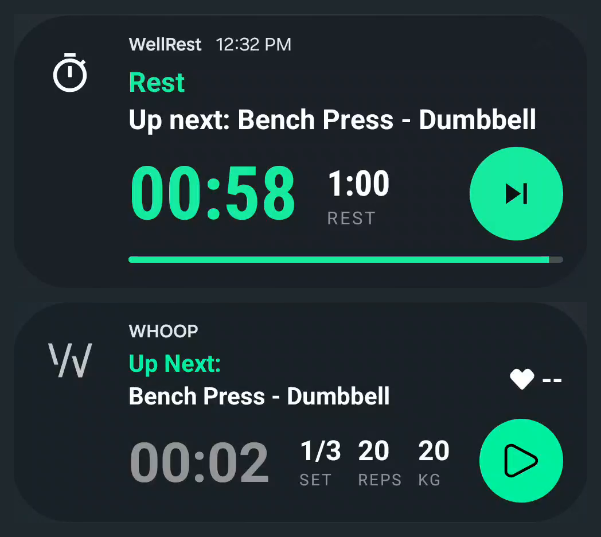
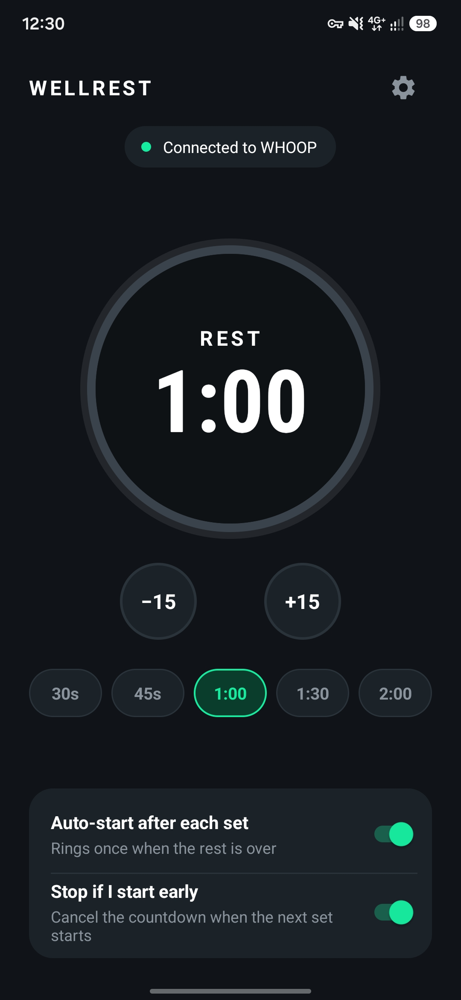
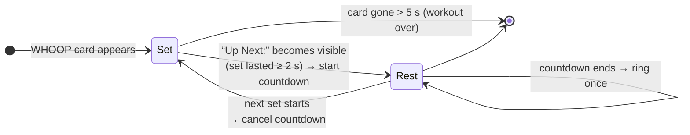

<div align="center">


# WellRest

**Automatic rest timer for WHOOP strength workouts.**
Finish a set, and the countdown starts on its own. When rest is over, it rings once.

[](https://github.com/Goudurixx/wellrest/actions/workflows/android-ci.yml)
[](https://github.com/Goudurixx/wellrest/actions/workflows/ios-ci.yml)
[](https://github.com/Goudurixx/wellrest/releases)


</div>

---

## Platforms

| | Folder | Status |
|---|---|---|
| **Android** (Kotlin) | [`android/`](android) | ✅ Working, automatic start from WHOOP's notification. Google Play coming soon |
| **iOS** (SwiftUI) | [`ios/`](ios) | 🚧 Planned: manual one-tap start + Live Activity. See the [handover plan](ios/HANDOVER.md) |
| Website & privacy policy | [`docs/`](docs) | ✅ [goudurixx.github.io/wellrest](https://goudurixx.github.io/wellrest/) |
| Shared design tokens & copy | [`shared/`](shared) | Used by both apps |

## Screenshots (Android)

| Rest countdown, next to WHOOP's own card | App |
|:---:|:---:|
|  |  |

## Why

The WHOOP Strength Trainer tracks your sets, but it doesn't tell you when your rest is over, and
the WHOOP app can't be modified. WellRest sits next to it: it follows WHOOP's workout notification,
starts a rest countdown the moment a set ends, and alerts you when it's time for the next one.

## Features

- **Hands-free** — starts automatically when WHOOP switches from a set to “Up Next”
- **Shows what's next** — the next exercise and a live countdown, in a card styled to match WHOOP's
- **Rings once, even on silent** — a single alert on the alarm stream, plus a double buzz
- **Adjustable rest** — 15 s to 10 min, ±15 s steps and 30 s / 45 s / 1:00 / 1:30 / 2:00 presets
- **Smart cancel** — stops by itself if you start the next set early
- **Private by design** — no internet permission, no account, no analytics; everything stays on the phone

## How it works (Android)



- `WhoopListener` — a `NotificationListenerService` that ignores every app except WHOOP, inflates
  WHOOP's custom notification layout and reads **only the text that is actually visible**
  (WHOOP keeps a hidden “Up Next” label in its layout). Short blips at workout start and
  remove/re-post cycles are filtered out.
- `RestTimer` / `RestService` — the countdown, shown through a short-lived foreground service so the
  card can be fully colorized; falls back to a regular notification if Android refuses.
- `MainActivity` / `SettingsActivity` — rest length and toggles; setup, detection tuning,
  a live listener log and the About section.

## Install

Download the latest APK from [Releases](https://github.com/Goudurixx/wellrest/releases)
(Google Play listing coming soon), then:

1. Open WellRest and allow **Notification access** when asked.
2. *Sideloaded APK only:* if the toggle is greyed out, go to App info → ⋮ → **Allow restricted settings** first.
3. Set battery usage to **Unrestricted** (Samsung: *Never sleeping apps*) so Android doesn't stop the listener.
4. Start a WHOOP Strength Trainer workout.

## Build

**Android:** JDK 17, Android SDK 36.

```bash
cd android
./gradlew assembleDebug        # android/app/build/outputs/apk/debug/
./gradlew lintDebug
```

**iOS:** Xcode 26. See [`ios/README.md`](ios/README.md).

## Releasing

Each platform has its own tag prefix, so the two release streams stay separate.

**Android:** [`android-release.yml`](.github/workflows/android-release.yml) runs on `android-v*` tags:

```bash
git tag android-v1.5.4 && git push origin android-v1.5.4
```

The workflow derives `versionCode` from the tag (`1.5.4` → `10504`), builds the signed **AAB** and
**APK**, attaches them to a GitHub Release with notes, and, if Play credentials are configured,
uploads the AAB to the Play **internal testing** track. Until the signing secrets below exist, it
publishes a **pre-release with a debug-signed preview APK** instead (installable, not for Play).

**iOS:** `ios-v*` tags, pipeline to be added (see [handover §7](ios/HANDOVER.md#7-release-pipeline-to-add-at-milestone-7)).

| Repository secret | Value |
|---|---|
| `KEYSTORE_BASE64` | `base64 -w0 upload-keystore.jks` |
| `KEYSTORE_PASSWORD` | keystore password |
| `KEY_ALIAS` | key alias (e.g. `upload`) |
| `KEY_PASSWORD` | key password |
| `PLAY_SERVICE_ACCOUNT_JSON` | *optional* — Play Console service-account JSON |

Create the upload key once and keep a backup outside the repo:

```bash
keytool -genkeypair -v -keystore upload-keystore.jks -alias upload \
  -keyalg RSA -keysize 4096 -validity 10000
```

For local release builds, put the same values in `keystore.properties` (git-ignored) — see
[`android/app/build.gradle.kts`](android/app/build.gradle.kts). Store submission notes are in [`android/STORE.md`](android/STORE.md).

## Privacy

On Android, WellRest reads only the WHOOP app's workout notification, processes it on the device and
never transmits anything. Neither app collects data. Full policy: **[goudurixx.github.io/wellrest/privacy-policy.html](https://goudurixx.github.io/wellrest/privacy-policy.html)**

## Disclaimer

WellRest is an independent project. It is not affiliated with, endorsed or sponsored by WHOOP, Inc.
WHOOP is a trademark of WHOOP, Inc.

---

<div align="center">
Made by <a href="https://github.com/Goudurixx">Sylvain Rousseau</a> · <a href="mailto:sylvain.rousseau.apps@gmail.com">sylvain.rousseau.apps@gmail.com</a>
</div>
